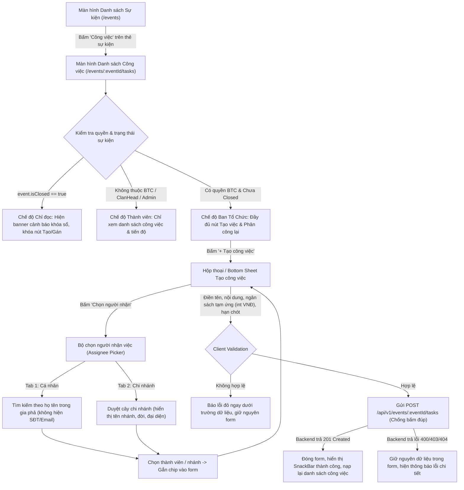

# UI Spec – US-07: Khởi Tạo Hạng Mục Công Việc & Phân Công Nhiệm Vụ Sự Kiện

Tài liệu đặc tả giao diện và hợp đồng tích hợp phía Frontend cho tính năng **[US-07] Khởi tạo hạng mục công việc chuẩn bị sự kiện (hậu cần, mua sắm...), phân công cho cá nhân hoặc nhánh gia phả, chuyển trạng thái tự động (`Unassigned` $\rightarrow$ `InProgress`) và phát thông báo bất đồng bộ**.

---

## 1. User Story & Tiêu Chí Nghiệm Thu (Acceptance Criteria)

* **Với vai trò:** Ban tổ chức sự kiện (`HeadOfOrganizer`, `OrganizerMember`), Trưởng tộc (`ROLE_CLAN_HEAD`), Quản trị viên (`ROLE_ADMIN`).
* **Tôi muốn:** Tạo các hạng mục công việc (hậu cần, mua sắm...) và gán cho cá nhân hoặc nhánh gia đình phụ trách.
* **Để:** Minh bạch hóa trách nhiệm và đảm bảo tiến độ chuẩn bị sự kiện.
* **Tiêu chí nghiệm thu (Acceptance Criteria):**
  - **Cho trước:** Sự kiện đã được khởi tạo và chưa bị khóa sổ (`event.status != Closed`). Đối tượng nhận việc (thành viên hoặc chi nhánh gia đình) phải tồn tại trong cây gia phả cùng dòng họ (`clan_id`).
  - **Khi:** Tôi thiết lập chi tiết công việc (tên công việc, nội dung, ngân sách tạm ứng dự kiến, hạn chót) và chọn người nhận (cá nhân và/hoặc nhánh gia phả).
  - **Thì:**
    1. Hệ thống lưu phân công (`event_tasks`), phát sinh mã `taskId` duy nhất dạng `TSK...`.
    2. Trạng thái công việc: Nếu đã chỉ định người/nhánh nhận thì chuyển sang `InProgress` ("Đang thực hiện"); nếu chưa chỉ định thì ở trạng thái `Unassigned` ("Chưa giao").
    3. Hệ thống kích hoạt thông báo bất đồng bộ (`TaskAssignedDomainEvent`) gửi đến tài khoản người nhận (hoặc toàn bộ thành viên đang sống trong nhánh).
    4. Giao diện hiển thị công việc mới trong danh sách với trạng thái do backend trả về.

---

## 2. Hợp Đồng API (Đối Chiếu Thực Tế Từ Repo Backend)

### 2.1. Bảng Tổng Hợp Endpoint

| Endpoint | Phương thức | Request DTO / Params | Response DTO | Quyền (@PreAuthorize) | File Backend Đã Đọc & Đối Chiếu |
|---|---|---|---|---|---|
| `/api/v1/events/{eventId}/tasks` | `POST` | Body: `CreateTaskRequest` | `ApiResponse<TaskResponse>` (HTTP 201) | `hasAnyRole('CLAN_HEAD', 'ADMIN') or @eventSecurity.hasContextualRole(#eventId, 'HeadOfOrganizer', 'OrganizerMember')` | [`TaskController.java`](file:///d:/WorkSpace/Family-Management/family-management-backend/src/main/java/com/familyfund/event/internal/controller/TaskController.java#L37-L46) [`TaskServiceImpl.java`](file:///d:/WorkSpace/Family-Management/family-management-backend/src/main/java/com/familyfund/event/internal/service/TaskServiceImpl.java#L50-L135) |
| `/api/v1/events/{eventId}/tasks/{taskId}/assign` | `POST` | Path: `eventId`, `taskId` Body: `AssignTaskRequest` | `ApiResponse<TaskResponse>` (HTTP 200) | `hasAnyRole('CLAN_HEAD', 'ADMIN') or @eventSecurity.hasContextualRole(#eventId, 'HeadOfOrganizer', 'OrganizerMember')` | [`TaskController.java`](file:///d:/WorkSpace/Family-Management/family-management-backend/src/main/java/com/familyfund/event/internal/controller/TaskController.java#L52-L61) [`TaskServiceImpl.java`](file:///d:/WorkSpace/Family-Management/family-management-backend/src/main/java/com/familyfund/event/internal/service/TaskServiceImpl.java#L137-L210) |
| `/api/v1/events/{eventId}/tasks` | `GET` | Path: `eventId` Query: `status`, `assignedMemberId`, `assignedBranchId` | `ApiResponse<List<TaskResponse>>` (HTTP 200) | `hasAnyRole('CLAN_HEAD', 'BRANCH_HEAD', 'MEMBER', 'ADMIN')` | [`TaskController.java`](file:///d:/WorkSpace/Family-Management/family-management-backend/src/main/java/com/familyfund/event/internal/controller/TaskController.java#L66-L76) [`TaskServiceImpl.java`](file:///d:/WorkSpace/Family-Management/family-management-backend/src/main/java/com/familyfund/event/internal/service/TaskServiceImpl.java#L212-L265) |
| `/api/v1/events/{eventId}/tasks/{taskId}` | `GET` | Path: `eventId`, `taskId` | `ApiResponse<TaskResponse>` (HTTP 200) | `hasAnyRole('CLAN_HEAD', 'BRANCH_HEAD', 'MEMBER', 'ADMIN')` | [`TaskController.java`](file:///d:/WorkSpace/Family-Management/family-management-backend/src/main/java/com/familyfund/event/internal/controller/TaskController.java#L81-L89) [`TaskServiceImpl.java`](file:///d:/WorkSpace/Family-Management/family-management-backend/src/main/java/com/familyfund/event/internal/service/TaskServiceImpl.java#L267-L287) |
| `/api/v1/branches/tree` | `GET` | Không | `ApiResponse<BranchTreeNodeResponse>` (HTTP 200) | `hasAnyRole('CLAN_HEAD', 'BRANCH_HEAD', 'MEMBER', 'ADMIN')` | [`GenealogyController.java`](file:///d:/WorkSpace/Family-Management/family-management-backend/src/main/java/com/familyfund/genealogy/internal/controller/GenealogyController.java#L57-L62) |
| `/api/v1/events/{eventId}` | `GET` | Path: `eventId` | `ApiResponse<EventDetailResponse>` (HTTP 200) | `hasAnyRole('CLAN_HEAD', 'BRANCH_HEAD', 'MEMBER', 'ADMIN')` | [`EventController.java`](file:///d:/WorkSpace/Family-Management/family-management-backend/src/main/java/com/familyfund/event/internal/controller/EventController.java#L69-L74) |

---

### 2.2. Chi Tiết Request / Response DTOs

#### DTO: `CreateTaskRequest` (Payload tạo công việc)
*Đọc từ [`CreateTaskRequest.java`](file:///d:/WorkSpace/Family-Management/family-management-backend/src/main/java/com/familyfund/event/internal/dto/request/CreateTaskRequest.java):*
* `taskName` (String, Bắt buộc): `@NotBlank`, `@Size(max = 100)`. Tối đa 100 ký tự.
* `details` (String, Tùy chọn): `@Size(max = 4000)`. Tối đa 4000 ký tự.
* `advanceBudget` (BigDecimal, Tùy chọn): `@DecimalMin("0.0")`, mặc định `0.0`. Đơn vị: VNĐ. Frontend nhập `int` (đồng), không dùng `double`.
* `deadline` (Instant, Bắt buộc): `@NotNull`, `@Future`. Phải là thời điểm trong tương lai (`deadline > now`) và **phải trước thời điểm diễn ra sự kiện** (`deadline < event.eventDatetime`). Định dạng: ISO-8601 UTC (`YYYY-MM-DDTHH:mm:ssZ`).
* `assignedBranchId` (String, Tùy chọn): `@Size(max = 20)`. ID của chi nhánh nhận việc (nếu có).
* `assignedMemberId` (String, Tùy chọn): `@Size(max = 20)`. ID của cá nhân phụ trách (nếu có).

#### DTO: `AssignTaskRequest` (Payload phân công / gán lại công việc)
*Đọc từ [`AssignTaskRequest.java`](file:///d:/WorkSpace/Family-Management/family-management-backend/src/main/java/com/familyfund/event/internal/dto/request/AssignTaskRequest.java):*
* `assignedBranchId` (String, Tùy chọn): `@Size(max = 20)`.
* `assignedMemberId` (String, Tùy chọn): `@Size(max = 20)`.
* Validation: `@AssertTrue` bắt buộc phải truyền ít nhất một trong hai trường (`assignedBranchId` hoặc `assignedMemberId`).

#### DTO: `TaskResponse` (Dữ liệu trả về của công việc)
*Đọc từ [`TaskResponse.java`](file:///d:/WorkSpace/Family-Management/family-management-backend/src/main/java/com/familyfund/event/internal/dto/response/TaskResponse.java):*
* `taskId` (String): Mã định danh duy nhất (dạng `TSK...`).
* `eventId` (String): Mã sự kiện.
* `taskName` (String): Tên công việc.
* `details` (String?): Nội dung chi tiết.
* `advanceBudget` (BigDecimal): Ngân sách tạm ứng dự kiến.
* `deadline` (Instant): Hạn chót công việc.
* `status` (TaskStatus): Enum gồm `Unassigned`, `InProgress`, `Completed`, `Overdue`.
* `assignedBranchId` (String?): Mã chi nhánh phụ trách.
* `assignedBranchName` (String?): Tên hiển thị của chi nhánh (backend tự map qua `GenealogyQueryService`).
* `assignedMemberId` (String?): Mã cá nhân phụ trách.
* `assignedMemberName` (String?): Họ tên cá nhân (backend tự map qua `GenealogyQueryService`).
* `createdBy` (String): Account ID người tạo công việc.

---

### 2.3. Giải Đáp Chi Tiết 7 Câu Hỏi Cốt Lõi Từ Backend

#### 1. Ai được tạo/gán công việc? Frontend lấy quyền từ đâu?
* **Quyền thực thi API:**
  - **Vai trò toàn cục:** `ROLE_CLAN_HEAD` (Trưởng tộc), `ROLE_ADMIN` (Quản trị viên hệ thống).
  - **Vai trò theo sự kiện (Contextual RBAC):** `HeadOfOrganizer` (Trưởng Ban tổ chức sự kiện), `OrganizerMember` (Thành viên Ban tổ chức sự kiện), với điều kiện `isReadOnly != true` và sự kiện chưa `Closed`.
* **Frontend lấy quyền từ đâu:**
  - Khi xem sự kiện, `GET /api/v1/events/{eventId}` trả về `EventDetailResponse` chứa danh sách `personnel: List<EventPersonnelResponse>`. Mỗi phần tử gồm `memberId`, `memberName`, `eventRole` (`HeadOfOrganizer`, `OrganizerMember`, `EventTreasurer`), `isReadOnly`.
  - Frontend so khớp: Nếu `session.isAdmin || session.isClanHead` $\rightarrow$ Đủ quyền. Nếu không, kiểm tra trong `event.personnel` xem có mục nào `memberId == session.memberId && !isReadOnly && (eventRole == 'HeadOfOrganizer' || eventRole == 'OrganizerMember')` hay không.
  - *Điểm cần lưu ý:* JWT Token sau đăng nhập **chỉ chứa global roles** (`roles`), không chứa quyền theo từng sự kiện. Frontend cần nạp chi tiết sự kiện để kiểm tra quyền BTC.

#### 2. Trạng thái sự kiện nào được tạo/gán công việc? Sự kiện Closed thì sao?
* **Các trạng thái cho phép:** `Draft`, `RegistrationOpen`, `RegistrationClosed`, `Ongoing`, `Ended` (miễn là hạn chót công việc `deadline < event.eventDatetime` và `deadline > now`).
* **Sự kiện Closed:** **Tuyệt đối bị cấm.**
  - Cả `TaskServiceImpl` (dòng 59, 147) và `EventSecurity` (dòng 77) đều chặn cứng: ném `BusinessRuleException: "Sự kiện đã kết thúc và khóa sổ, không thể tạo hoặc phân công công việc"`.
  - Trên Frontend: Chuyển màn hình sang **Chế độ Chỉ đọc (Read-only)**, ẩn hoặc vô hiệu hóa các nút "+ Tạo công việc" và "Phân công lại", hiển thị thông báo banner giải thích: *"Sự kiện đã kết thúc và khóa sổ (Closed). Danh sách công việc được lưu trữ ở chế độ Chỉ đọc."*

#### 3. Danh sách trạng thái công việc chính thức và quy tắc chuyển trạng thái; ai được đổi? Có sẵn sửa/gán lại/xóa không?
* **4 trạng thái chính thức (`TaskStatus` enum):**
  - `Unassigned`: "Chưa giao" — Công việc được tạo nhưng chưa gán cho cá nhân hoặc nhánh nào.
  - `InProgress`: "Đang thực hiện" — Công việc đã được phân công cho cá nhân hoặc nhánh.
  - `Completed`: "Đã hoàn thành" — Công việc đã xong (do người nhận cập nhật tiến độ / quyết toán).
  - `Overdue`: "Quá hạn" — Đã quá `deadline` mà chưa hoàn thành.
* **Quy tắc chuyển trạng thái (`TaskStatus.canTransitionTo`):**
  - `Unassigned -> InProgress` (khi phân công người/nhánh).
  - `InProgress -> Completed, Overdue, Unassigned`.
  - `Overdue -> Completed, InProgress`.
  - `Completed -> InProgress`.
* **Ai được đổi:**
  - Ban tổ chức (`HeadOfOrganizer`, `OrganizerMember`), Trưởng tộc, hoặc Admin gọi endpoint `POST /assign` để chuyển từ `Unassigned -> InProgress`.
  - Nếu công việc đã ở trạng thái `Completed`, backend **chặn không cho phân công lại** (`BusinessRuleException: "Công việc đã hoàn thành, không thể phân công lại"`).
* **Về tính năng Sửa / Gán lại / Xóa công việc trong backend:**
  - **Gán lại (Reassign):** Backend **ĐÃ CÓ SẴN** qua endpoint `POST /api/v1/events/{eventId}/tasks/{taskId}/assign`. Hỗ trợ gán lại cho công việc `Unassigned`, `InProgress`, hoặc `Overdue`. **Đề xuất đưa vào phạm vi lần này.**
  - **Sửa chi tiết (tên, mô tả, ngân sách, hạn chót):** Backend **CHƯA CÓ** endpoint `PUT` hoặc `PATCH` để sửa task.
  - **Xóa công việc:** Backend **CHƯA CÓ** endpoint `DELETE` để xóa task.
  - *(Đã ghi nhận vào mục 10: "Đề nghị backend").*

#### 4. "Người nhận" gửi lên API ra sao? Endpoint tìm kiếm? US-25 & Hồ sơ ảo?
* **Cấu trúc gửi lên API:** Gồm **2 trường riêng biệt** kiểu String ($\le 20$ ký tự):
  - `assignedBranchId`: Mã chi nhánh (ví dụ `"BR10000001"`).
  - `assignedMemberId`: Mã thành viên (ví dụ `"MEM10000002"`).
  - Cho phép 3 kịch bản: Gán riêng cho cá nhân, gán riêng cho nhánh, hoặc gán cho cá nhân đại diện của nhánh.
* **Endpoint tìm cá nhân / nhánh:**
  - **Nhánh gia đình:** Gọi `GET /api/v1/branches/tree` (đã có trong backend). Dữ liệu trả về cây chi nhánh `BranchTreeNodeResponse` gồm `branchId`, `branchName`, `generationLevel`, `representativeName`, `memberCount`.
  - **Cá nhân:** Backend hiện chưa có endpoint `GET /clans/{clanId}/members` được cài đặt đầy đủ trong Spring Boot để tìm kiếm phân trang. Backend hiện tại hỗ trợ `GenealogyQueryService.findMemberSummary(memberId)` (trả `memberId`, `fullName`, `clanId`, `branchId`).
  - **Bảo mật dữ liệu cá nhân (US-25):** Giao diện bộ chọn **tuyệt đối không hiển thị SĐT, email, ngày sinh**. Chỉ hiển thị họ tên, đời thứ, chi nhánh.
  - **Gán cho hồ sơ ảo (chưa có tài khoản / `is_placeholder = true`):**
    - Backend **HOÀN TOÀN CHO PHÉP** (chỉ xác thực `findMemberSummary(memberId)` tồn tại và thuộc `clanId`).
    - **Thông báo gửi đi đâu:** Bản ghi thông báo được lưu vào bảng `event_notifications` gắn với `eventId`. Với hồ sơ ảo chưa có tài khoản đăng nhập, thông báo vẫn lưu trong nhật ký sự kiện; nếu gán kèm chi nhánh (`assignedBranchId`), hệ thống tự động tìm toàn bộ thành viên đang sống trong chi nhánh đó để phát thông báo.

#### 5. Ràng buộc dữ liệu (Validation Rules)
* `taskName`: Bắt buộc, cắt khoảng trắng đầu cuối, độ dài từ 1 đến 100 ký tự.
* `details`: Tùy chọn, tối đa 4000 ký tự.
* `advanceBudget`: Kiểu số nguyên `int` đơn vị VNĐ trên frontend (backend lưu `BigDecimal`, min 0.0). Nhập có định dạng hàng nghìn (ví dụ: `1.500.000 ₫`), mặc định `0 ₫`.
  - **Có bị so với ngân sách tổng sự kiện không?** **KHÔNG.** Backend không chặn `advanceBudget > event.estimatedBudget` vì tạm ứng các hạng mục có thể được chuẩn bị độc lập hoặc từ nhiều nguồn.
* `deadline`:
  - Định dạng ISO-8601 UTC string (`YYYY-MM-DDTHH:mm:ssZ`).
  - Phải ở **tương lai** (`deadline > now`). Không được ở quá khứ.
  - Phải **trước thời điểm diễn ra sự kiện** (`deadline < event.eventDatetime`).

#### 6. Danh sách công việc: Phân trang, Sắp xếp, Bộ lọc
* **Phân trang:** Backend trả về danh sách phẳng toàn bộ `List<TaskResponse>`, chưa phân trang server-side.
* **Sắp xếp:** Backend tự động sắp xếp theo thời hạn hoàn thành tăng dần (`deadline ASC`).
* **Bộ lọc (Query Parameters):**
  - `status`: Lọc theo trạng thái (`Unassigned`, `InProgress`, `Completed`, `Overdue`).
  - `assignedMemberId`: Lọc theo mã cá nhân phụ trách.
  - `assignedBranchId`: Lọc theo mã chi nhánh phụ trách.

#### 7. Mã lỗi nghiệp vụ & Xử lý phía Client
* `400 Bad Request`:
  - `"Sự kiện đã kết thúc và khóa sổ, không thể tạo hoặc phân công công việc"` $\rightarrow$ Hiển thị thông báo, khóa form và làm mới trạng thái sự kiện.
  - `"Hạn chót công việc phải trước thời gian diễn ra sự kiện"` $\rightarrow$ Đánh dấu đỏ trường Hạn chót và yêu cầu chọn lại.
  - `"Hạn chót công việc phải là thời điểm trong tương lai"` $\rightarrow$ Đánh dấu đỏ trường Hạn chót.
  - `"Phải chỉ định ít nhất cá nhân hoặc nhánh gia đình phụ trách"` $\rightarrow$ Đánh dấu đỏ phần Người nhận khi gọi Gán việc.
  - `"Công việc đã hoàn thành, không thể phân công lại"` $\rightarrow$ Thông báo Toast/SnackBar cảnh báo.
  - Lỗi validation: Hiển thị đúng thông điệp lỗi dưới từng trường form.
* `403 Forbidden`: Người dùng không có quyền quản lý công việc (không phải Admin, Trưởng tộc, hoặc BTC). $\rightarrow$ Ẩn nút thao tác hoặc hiển thị thông báo phân quyền.
* `404 Not Found`: Không tìm thấy sự kiện, công việc, thành viên hoặc chi nhánh trong gia phả.

---

## 3. Màn Hình Và Luồng Người Dùng

### 3.1. Danh Sách Màn Hình & Hộp Thoại

| # | Màn hình / Thành phần | Vai trò sử dụng | Tạo mới / Sửa | Route / Trigger |
|---|---|---|---|---|
| 1 | `EventTaskListScreen` (Danh sách công việc sự kiện) | Tất cả thành viên xem; BTC / Trưởng tộc / Admin quản lý | Tạo mới | `/events/:eventId/tasks` |
| 2 | `CreateTaskDialog` (Web) / `CreateTaskSheet` (Mobile) | BTC, Trưởng tộc, Admin | Tạo mới | Nút "+ Tạo công việc" trên màn hình 1 |
| 3 | `AssigneePickerDialog` (Bộ chọn người nhận: 2 tab) | BTC, Trưởng tộc, Admin | Tạo mới | Nút "Chọn người nhận" trong form tạo/gán |
| 4 | `AssignTaskDialog` (Hộp thoại gán lại người phụ trách) | BTC, Trưởng tộc, Admin | Tạo mới | Nút "Phân công lại" trên thẻ công việc |
| 5 | `EventCard` & `EventDetailDialog` (Cầu nối sự kiện) | Tất cả | Sửa | Thêm nút "Công việc chuẩn bị" dẫn vào màn hình 1 |

### 3.2. Sơ Đồ Luồng Nghiệp Vụ (User Flow)

---

## 4. Ma Trận Quyền × Trạng Thái (RBAC Matrix)

| Hành động | Thành viên thường | Trưởng chi | Trưởng tộc | Trưởng BTC | Thành viên BTC | Thủ quỹ sự kiện | Sự kiện Closed (Chỉ đọc) |
|---|---|---|---|---|---|---|---|
| Xem danh sách & lọc công việc | Cho phép | Cho phép | Cho phép | Cho phép | Cho phép | Cho phép | Cho phép (Chỉ đọc) |
| Xem chi tiết một công việc | Cho phép | Cho phép | Cho phép | Cho phép | Cho phép | Cho phép | Cho phép (Chỉ đọc) |
| Tạo công việc mới (`POST /tasks`) | Chặn | Chặn | Cho phép | Cho phép | Cho phép | Chặn | **Chặn hoàn toàn** |
| Gán lại người nhận (`POST /assign`) | Chặn | Chặn | Cho phép | Cho phép | Cho phép | Chặn | **Chặn hoàn toàn** |
| Gán cho công việc đã `Completed` | Chặn | Chặn | Chặn (Backend cấm) | Chặn (Backend cấm) | Chặn (Backend cấm) | Chặn | Chặn |

*Ghi chú:*
- Trưởng chi nhánh nếu được chỉ định vào Ban tổ chức sự kiện với vai trò `HeadOfOrganizer` hoặc `OrganizerMember` sẽ được cấp quyền theo ngữ cảnh của sự kiện đó.
- Thủ quỹ sự kiện (`EventTreasurer`) chỉ quản lý tài chính/tạm ứng/quyết toán (`canMutateEventFinance`), không có quyền tạo hoặc phân công công việc nếu không kiêm nhiệm BTC.

---

## 5. Chi Tiết Từng Màn Hình & Giao Diện Thích Ứng

### 5.1. Màn hình 1: Danh Sách Công Việc Chuẩn Bị (`EventTaskListScreen`)

* **Mục đích:** Xem toàn bộ các hạng mục chuẩn bị cho sự kiện, lọc theo trạng thái, theo dõi tiến độ, và cung cấp lối vào tạo việc cho Ban tổ chức.
* **Bố cục Web (~1280px):**
  - Thanh breadcrumb dẫn đường: `Sự kiện dòng họ` > `Lễ Giỗ Tổ 2026` > `Hạng mục chuẩn bị`.
  - Header sự kiện: Tên sự kiện, ngày diễn ra, địa điểm, huy hiệu trạng thái vòng đời.
  - Thanh công cụ phía trên: Thanh tìm kiếm theo tên việc/người nhận, bộ lọc Chip theo trạng thái (`Tất cả`, `Chưa giao`, `Đang thực hiện`, `Đã hoàn thành`, `Quá hạn`), nút chính `+ Tạo công việc` (nổi bật với màu Đỏ son `primaryCrimson`).
  - Danh sách công việc dạng lưới thẻ thích ứng (Grid 2 hoặc 3 cột tùy độ rộng màn hình).
* **Bố cục Mobile (~390px):**
  - AppBar với nút Back, tiêu đề tóm tắt sự kiện.
  - Thanh lọc ngang có thể cuộn (`ListView` horizontal).
  - Danh sách thẻ công việc xếp dọc (1 cột), hỗ trợ kéo để làm mới (`RefreshIndicator`).
  - Nút bấm `+ Tạo công việc` cố định ở góc dưới dạng Floating Action Button mở rộng.
* **Đủ 5 trạng thái màn hình:**
  1. *Đang tải:* Hiển thị 3 khung thẻ mờ dạng Shimmer / Skeleton hoặc `CircularProgressIndicator` căn giữa.
  2. *Rỗng:* Minh họa trang nhã kèm thông điệp: *"Chưa có hạng mục công việc nào cho sự kiện này."* Kèm nút `+ Tạo công việc đầu tiên` (nếu có quyền BTC).
  3. *Lỗi:* Thông điệp lỗi rõ ràng lấy từ `Failure.message` kèm nút `Thử lại`.
  4. *Không đủ quyền:* Banner thông báo màu trung tính: *"Bạn đang xem danh sách công việc ở chế độ Thành viên. Chỉ Ban tổ chức, Trưởng tộc hoặc Quản trị viên mới có quyền tạo và phân công việc."*
  5. *Chỉ đọc khi sự kiện Closed:* Banner màu hổ phách `warningExplanationAmber` phía trên cùng: *"Sự kiện đã kết thúc và khóa sổ (Closed). Danh sách công việc được lưu trữ ở chế độ Chỉ đọc."* Tất cả nút Tạo/Gán bị ẩn hoặc vô hiệu hóa.

---

### 5.2. Màn hình 2: Hộp Thoại / Bottom Sheet Tạo Công Việc (`CreateTaskDialog` / `CreateTaskSheet`)

* **Mục đích:** Cho phép Ban tổ chức nhập thông tin hạng mục công việc, ngân sách tạm ứng dự kiến, hạn chót và chỉ định người nhận.
* **Bố cục:**
  - Web: Hộp thoại `Dialog` nổi ở giữa màn hình với `maxWidth: 580px`.
  - Mobile: `ModalBottomSheet` có thanh kéo (drag handle), hỗ trợ cuộn khi bàn phím mở lên (`isScrollControlled: true`).
* **Trường dữ liệu & Kiểm tra hợp lệ (Client Validation):**
  - `Tên công việc` (`taskName`): Bắt buộc, không được để trống, tối đa 100 ký tự. Có bộ đếm ký tự `(0/100)`.
  - `Nội dung chi tiết` (`details`): Tùy chọn, tối đa 4000 ký tự.
  - `Ngân sách tạm ứng dự kiến` (`advanceBudget`): Ô nhập tiền tệ, tự động format phân tách hàng nghìn (ví dụ: `2.000.000 ₫`). Lưu trữ nội bộ dưới dạng số nguyên `int` (đồng). Chú thích nhỏ: *"Ngân sách dự kiến chuẩn bị, phiếu tạm ứng thực tế sẽ do Thủ quỹ phê duyệt."*
  - `Hạn chót hoàn thành` (`deadline`): Bộ chọn Ngày & Giờ (`DatePicker` + `TimePicker`).
    - Validation: Phải là thời điểm tương lai (`deadline > now`) và phải trước ngày diễn ra sự kiện (`deadline < event.eventDatetime`). Nếu chọn sai, hiển thị lỗi đỏ ngay dưới ô chọn.
  - `Đối tượng nhận việc` (Tùy chọn khi tạo):
    - Khối hiển thị đối tượng nhận việc hiện tại (hoặc nhãn *"Chưa giao (Unassigned)"*).
    - Nút bấm *"Chọn người nhận"* mở Bộ chọn `AssigneePickerDialog`.
    - Sau khi chọn: Hiển thị Chip tên người nhận/nhánh kèm nút `x` để xóa nếu muốn hủy gán.
* **Hành động & Chống bấm đúp:**
  - Nút `Lưu công việc`: Nút chính (`primaryCrimson`). Khi đang submit, chuyển sang trạng thái disabled và hiện con quay tải nhỏ, ngăn chặn người dùng bấm nhiều lần.
  - Nút `Hủy`: Đóng hộp thoại mà không lưu.
  - Khi lưu lỗi: Giữ nguyên dữ liệu người dùng đã nhập trong form, không xóa trắng, hiển thị SnackBar/Alert thông báo lỗi từ backend.

---

### 5.3. Màn hình 3: Bộ Chọn Người Nhận Việc (`AssigneePickerDialog` / `AssigneePickerSheet`)

* **Mục đích:** Chọn cá nhân hoặc chi nhánh phụ trách công việc, tuân thủ nghiêm ngặt bảo mật dữ liệu cá nhân theo US-25.
* **Bố cục 2 Tab rõ ràng:**
  - **Tab 1: Cá nhân (`Cá nhân trong gia tộc`)**
    - Thanh tìm kiếm theo họ tên thành viên.
    - Danh sách thành viên hiển thị thẻ thông tin tối giản: Họ và tên, thế hệ (Đời thứ V...), chi nhánh trực thuộc.
    - **RÀNG BUỘC US-25:** Tuyệt đối không hiển thị Số điện thoại, Email, Ngày tháng năm sinh.
    - Hỗ trợ chọn hồ sơ thành viên (kể cả hồ sơ ảo chưa kích hoạt tài khoản).
  - **Tab 2: Nhánh gia đình (`Chi nhánh gia phả`)**
    - Cây chi nhánh trực quan được làm phẳng (`flattened list`) với độ thụt lề theo cấp thế hệ (`depth * 16px`).
    - Mỗi mục chi nhánh hiển thị: Tên chi nhánh, cấp thế hệ (`Đời thứ...`), tên người đại diện chi nhánh, số lượng thành viên trong nhánh.
    - Tái sử dụng dữ liệu từ endpoint `GET /api/v1/branches/tree`.
* **Hành động:** Nút `Xác nhận` trả về thông tin người nhận cho form tạo/gán việc.

---

### 5.4. Màn hình 4: Hộp Thoại Gán Lại Công Việc (`AssignTaskDialog`)

* **Mục đích:** Phân công một công việc đang `Unassigned` hoặc điều chuyển người nhận việc đối với công việc đang `InProgress` / `Overdue`.
* **Quy tắc:**
  - Nếu công việc đã `Completed`, nút bị ẩn/khóa kèm tooltip: *"Công việc đã hoàn thành, không thể phân công lại."*
  - Cho phép chọn lại Cá nhân và/hoặc Chi nhánh.
  - Gửi request đến `POST /api/v1/events/{eventId}/tasks/{taskId}/assign`.

---

## 6. So Sánh Thiết Kế Stitch ↔ AppTheme Dự Án

Màn hình Stitch tham chiếu: `projects/286117820646935235/screens/d4463049da0b47e2a95620ed9935e92a` ("Quản Lý Sự Kiện & Phân Công Nhiệm Vụ").

| Thành phần | Thiết kế trong Stitch | Chuẩn của dự án (`AppTheme`) | Quyết định & Đề xuất |
|---|---|---|---|
| Màu chính (Primary) | `#8f482f` / `#cc785c` (Đất nung Terracotta) | `Color(0xFF8B1E1E)` (`primaryCrimson` - Đỏ son) | **Dùng `AppTheme.primaryCrimson`** làm chuẩn nhận diện thương hiệu của app Flutter. |
| Màu phụ (Secondary) | `#006e2a` / `#2e8b43` (Xanh lục sổ cái) | `Color(0xFFB8860B)` (`secondaryGold` - Vàng đồng ấm) | **Dùng `AppTheme.secondaryGold`** cho các huy hiệu tế sự, và dùng màu lục nhạt cho trạng thái hoàn tất. |
| Màu nền (Background) | `#fcf9f6` | `Color(0xFFF9F8F6)` (`scaffoldBackgroundColor`) | Đồng nhất tông màu giấy điệp / giấy dó truyền thống. |
| Phông chữ hiển thị | Merriweather + Plus Jakarta Sans + JetBrains Mono | Hệ thống phông Material 3 (hỗ trợ tiếng Việt có dấu đầy đủ) | Giữ typography chuẩn của ứng dụng, đảm bảo dấu tiếng Việt không bị lỗi hiển thị. |
| Bố cục Desktop | Kanban 3 cột ngang (Cần làm / Đang làm / Đã quyết toán) | Lưới thẻ thích ứng (Grid / Danh sách thẻ) kèm Tabs lọc trạng thái | Áp dụng thẻ phân loại theo trạng thái chính thức của backend (`Unassigned`, `InProgress`, `Completed`, `Overdue`). |
| Khung Mobile (~390px) | **Chưa có trong Stitch** (Stitch chỉ có bản Desktop) | Thiết kế dạng danh sách dọc với thanh cuộn tab lọc ngang | **Đề xuất mới hoàn toàn cho Mobile** theo hướng dẫn của `04-ui-ux-design.md`. |

---

## 7. Tái Sử Dụng Và Tạo Mới

### 7.1. Tái Sử Dụng
* `AppTheme`: Dùng màu ngữ nghĩa `primaryCrimson`, `secondaryGold`, `immutableLedgerTeal`, `warningExplanationAmber`.
* `AppFormatters`: Dùng `formatVnd(num amount)` cho tiền tệ (được truyền số nguyên `int` đồng), `formatDateTime(DateTime dt)` cho hạn chót.
* `DualRbacSession`: Sử dụng `session.isAdmin`, `session.isClanHead`, `session.memberId` để xác thực quyền hạn.
* `BranchTreeNodeResponse` / logic duyệt cây chi nhánh: Kế thừa mô hình từ `GET /api/v1/branches/tree` (tương tự như màn hình `RegisterMemberScreen` trong US-17).
* `EventModel`: Tái sử dụng model sự kiện hiện có để kiểm tra `event.isClosed`, `event.eventDatetime`, `event.personnel`.

### 7.2. Tạo Mới Trong `lib/features/task/`
* `data/models/task_models.dart`: Định nghĩa `TaskModel`, `CreateTaskRequestDto`, `AssignTaskRequestDto`, `TaskStatusEnum`.
* `data/datasources/task_remote_datasource.dart`: Thực hiện các cuộc gọi HTTP qua `DioClient`, xử lý mã lỗi backend, **không thêm fallback mock**.
* `data/repositories/task_repository_impl.dart`: Ánh xạ `DioException` sang `Failure` theo chuẩn kiến trúc.
* `domain/repositories/task_repository.dart`: Interface trừu tượng cho Task repository.
* `presentation/providers/task_providers.dart`: Riverpod providers quản lý danh sách công việc, bộ lọc, và trạng thái thao tác lưu (`AsyncValue`).
* `presentation/screens/event_task_list_screen.dart`: Màn hình danh sách công việc (Web 1280px + Mobile 390px).
* `presentation/widgets/task_card.dart`: Thẻ hiển thị công việc.
* `presentation/widgets/create_task_dialog.dart`: Dialog/Sheet tạo công việc mới.
* `presentation/widgets/assign_task_dialog.dart`: Dialog/Sheet phân công lại công việc.
* `presentation/widgets/assignee_picker_dialog.dart`: Bộ chọn người nhận 2 tab (Cá nhân / Chi nhánh).

---

## 8. Danh Sách File Sẽ Tạo / Sửa

### Files Tạo Mới (Trong `lib/features/task/`):
1. `lib/features/task/data/models/task_models.dart`
2. `lib/features/task/data/datasources/task_remote_datasource.dart`
3. `lib/features/task/data/repositories/task_repository_impl.dart`
4. `lib/features/task/domain/repositories/task_repository.dart`
5. `lib/features/task/presentation/providers/task_providers.dart`
6. `lib/features/task/presentation/screens/event_task_list_screen.dart`
7. `lib/features/task/presentation/widgets/task_card.dart`
8. `lib/features/task/presentation/widgets/create_task_dialog.dart`
9. `lib/features/task/presentation/widgets/assign_task_dialog.dart`
10. `lib/features/task/presentation/widgets/assignee_picker_dialog.dart`

### Files Dùng Chung Có Nguy Cơ Xung Đột (Cần Sửa Nhỏ Nhất Có Thể):
1. `lib/core/router/app_router.dart`: Thêm GoRoute `/events/:eventId/tasks` trỏ tới `EventTaskListScreen`.
2. `lib/core/security/rbac_models.dart`: Bổ sung getter tiện ích `canManageTasksForEvent(EventModel event)` kết nối kiểm tra quyền BTC với danh sách `event.personnel`.
3. `lib/features/event/presentation/widgets/event_card.dart`: Thêm nút/hành động "Công việc" để mở màn hình danh sách công việc của sự kiện.
4. `lib/features/event/presentation/widgets/event_detail_dialog.dart`: Thêm nút mở danh sách công việc trong popup chi tiết sự kiện.

---

## 9. Rủi Ro Và Nợ Kỹ Thuật Chạm Tới

1. **Nợ kỹ thuật `EventModel` dùng `double` cho tiền:**
   - Trong `features/event`, các trường ngân sách đang dùng `double`.
   - **Biện pháp cô lập:** Trong feature mới `features/task`, toàn bộ `advanceBudget` sẽ dùng kiểu `int` (đơn vị đồng), tuyệt đối không dùng `double` để lưu trữ hay tính toán số liệu chính thức.
2. **Nợ kỹ thuật Fallback Mock trong repo:**
   - `EventRemoteDataSource` hiện tại có nhiều fallback mock khi gặp lỗi.
   - **Quy tắc tuyệt đối:** `TaskRemoteDataSource` **không viết fallback mock**; ném lỗi thật để UI hiển thị thông báo chính xác cho người dùng.
3. **Chưa có endpoint tìm kiếm danh sách thành viên toàn diện:**
   - Backend chưa có endpoint `GET /clans/{clanId}/members` được cài đặt đầy đủ.
   - **Giải pháp tạm thời:** Tab Cá nhân sẽ nạp danh sách thành viên đại diện từ cây chi nhánh (`BranchTreeNodeResponse`) và các nhân sự đã có trong sự kiện (`event.personnel`), đồng thời đề nghị backend mở rộng endpoint tìm kiếm thành viên.

---

## 10. Câu Hỏi Mở & Đề Nghị Backend

### 10.1. Đề Nghị Backend
1. **API Sửa & Xóa công việc:** Backend hiện tại chỉ có API tạo (`POST /tasks`) và gán (`POST /tasks/{id}/assign`), chưa có `PUT /tasks/{taskId}` (sửa tên, nội dung, hạn chót, ngân sách) và `DELETE /tasks/{taskId}` (xóa việc). Đề nghị backend bổ sung 2 API này trong story tiếp theo.
2. **Tiện ích kiểm tra quyền theo sự kiện:** Đề nghị backend bổ sung trường `myRole: EventRole?` và `canManageTasks: boolean` trong response của `GET /api/v1/events/{eventId}`, hoặc cung cấp endpoint `/api/v1/events/{eventId}/my-permissions` để frontend không phải duyệt thủ công mảng `personnel`.
3. **Endpoint tra cứu thành viên gia phả an toàn:** Cung cấp endpoint `GET /api/v1/clans/members?keyword=...` hỗ trợ tìm kiếm phân trang theo tên và chi nhánh, tuân thủ US-25 (chỉ trả `memberId`, `fullName`, `branchName`, `generation`, không trả SĐT/email/ngày sinh).

### 10.2. Câu Hỏi Mở Chờ Người Dùng Quyết Định
1. *Về tính năng Gán lại (Reassign):* Backend đã có sẵn endpoint `POST /events/{eventId}/tasks/{taskId}/assign`. Bạn có đồng ý đưa nút "Phân công lại" vào giao diện thẻ công việc lần này không? (Khuyến nghị: **Có**).
2. *Về tính năng Sửa / Xóa công việc:* Do backend chưa có endpoint, chúng ta sẽ tạm thời chưa đưa nút Sửa/Xóa vào giao diện lần này và chờ backend triển khai thêm. Bạn có đồng ý với phương án này không?

