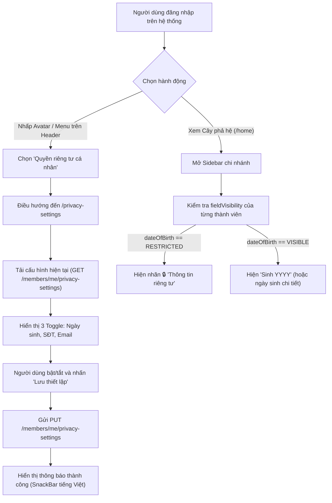

# UI Spec – US-25: Bảo Vệ Thông Tin Cá Nhân Thành Viên (Hybrid Privacy)

Tài liệu đặc tả giao diện và hợp đồng tích hợp phía Frontend cho tính năng **[US-25] Bảo vệ thông tin cá nhân thành viên (Ngày sinh, Số điện thoại, Email) theo mô hình Hybrid Privacy: Kết hợp RBAC & Quyền tự quyết của chính chủ**.

---

## 1. User Story & Tiêu Chí Nghiệm Thu
* **Với vai trò:** Thành viên dòng họ (`ROLE_MEMBER`), Trưởng nhánh (`ROLE_BRANCH_HEAD`), Trưởng tộc (`ROLE_CLAN_HEAD`).
* **Tôi muốn:** 
  1. Khi xem người khác trong gia phả: chỉ thấy thông tin cơ bản; thông tin nhạy cảm (ngày sinh, SĐT, email) chỉ hiển thị nếu chính chủ cho phép hoặc tôi có quyền quản lý thích hợp.
  2. Với hồ sơ của chính mình: có thể chủ động cài đặt bật/tắt cho phép chia sẻ ngày sinh, số điện thoại, email cho mọi người trong dòng họ xem.
* **Để:** Bảo vệ quyền riêng tư cá nhân theo nguyên tắc *Privacy by Default*, đồng thời tôn trọng quyền tự quyết của từng thành viên.
* **Tiêu chí nghiệm thu (Acceptance Criteria):**
  - **Cho trước:** Hồ sơ thành viên có ngày sinh trong bảng `members` và SĐT, email trong `user_accounts`.
  - **Khi (Thành viên xem hồ sơ người khác):**
    - Nếu chính chủ **chưa bật chia sẻ** (`shareDateOfBirth = false`): Trường ngày sinh hiển thị nhãn *“Thông tin riêng tư”* 🔒, không hiển thị năm sinh suy ra.
    - Nếu chính chủ **bật chia sẻ** (`shareDateOfBirth = true`): Hiển thị ngày sinh bình thường (hoặc *Sinh năm YYYY*).
    - Tương tự với Số điện thoại và Email: Ẩn hoặc hiện độc lập theo từng cờ chia sẻ.
  - **Khi (Trưởng tộc / Trưởng nhánh quản lý xem):**
    - Trưởng tộc xem được toàn bộ thông tin nhạy cảm của các thành viên trong dòng họ mình.
    - Trưởng nhánh xem được thông tin nhạy cảm của thành viên thuộc nhánh mình đại diện và các nhánh con.
  - **Khi (Chính chủ vào Cài đặt quyền riêng tư):**
    - Xem được trạng thái bật/tắt hiện tại của 3 cờ: Ngày sinh, Số điện thoại, Email.
    - Thay đổi toggle switch và lưu thành công; sau khi lưu, trạng thái trên cây phả hệ cập nhật ngay lập tức.

---

## 2. Hợp Đồng API (Đối Chiếu Thực Tế Từ Repo Backend)

### 2.1. Bảng Tổng Hợp Endpoint
| Endpoint | Phương thức | Request DTO / Params | Response DTO | Quyền | File Backend Đã Đọc & Đối Chiếu |
|---|---|---|---|---|---|
| `/api/v1/members/me/privacy-settings` | `GET` | Không | `ApiResponse<MemberPrivacySettingResponse>` | Đã đăng nhập (`isAuthenticated()`) | [`MemberPrivacyController.java`](file:///d:/WorkSpace/Family-Management/family-management-backend/src/main/java/com/familyfund/genealogy/internal/controller/MemberPrivacyController.java#L26-L31)<br>[`MemberPrivacySettingServiceImpl.java`](file:///d:/WorkSpace/Family-Management/family-management-backend/src/main/java/com/familyfund/genealogy/internal/service/MemberPrivacySettingServiceImpl.java#L30-L45) |
| `/api/v1/members/me/privacy-settings` | `PUT` | Body: `UpdateMemberPrivacySettingRequest` | `ApiResponse<MemberPrivacySettingResponse>` | Đã đăng nhập (`isAuthenticated()`) | [`MemberPrivacyController.java`](file:///d:/WorkSpace/Family-Management/family-management-backend/src/main/java/com/familyfund/genealogy/internal/controller/MemberPrivacyController.java#L33-L40)<br>[`MemberPrivacySettingServiceImpl.java`](file:///d:/WorkSpace/Family-Management/family-management-backend/src/main/java/com/familyfund/genealogy/internal/service/MemberPrivacySettingServiceImpl.java#L47-L70) |
| `/api/v1/branches/{branchId}/members` | `GET` | Path variable `branchId` | `ApiResponse<List<MemberResponse>>` | `CLAN_HEAD`, `BRANCH_HEAD`, `MEMBER`, `ADMIN` | [`MemberController.java`](file:///d:/WorkSpace/Family-Management/family-management-backend/src/main/java/com/familyfund/genealogy/internal/controller/MemberController.java#L50-L56)<br>[`MemberServiceImpl.java`](file:///d:/WorkSpace/Family-Management/family-management-backend/src/main/java/com/familyfund/genealogy/internal/service/MemberServiceImpl.java#L114-L126) |
| `/api/v1/members` | `GET` | Không | `ApiResponse<List<MemberResponse>>` | `CLAN_HEAD`, `BRANCH_HEAD`, `MEMBER`, `ADMIN` | [`MemberController.java`](file:///d:/WorkSpace/Family-Management/family-management-backend/src/main/java/com/familyfund/genealogy/internal/controller/MemberController.java#L58-L63) |
| `/api/v1/members/search` | `GET` | Query params: `keyword`, `memberId`, `fullName`, `generation`, `branchId`, `status` | `ApiResponse<List<MemberResponse>>` | `CLAN_HEAD`, `BRANCH_HEAD`, `MEMBER`, `ADMIN` | [`MemberController.java`](file:///d:/WorkSpace/Family-Management/family-management-backend/src/main/java/com/familyfund/genealogy/internal/controller/MemberController.java#L65-L77) |

---

### 2.2. Chi Tiết Request / Response DTOs

#### DTO: `MemberPrivacySettingResponse`
*Đọc từ [`MemberPrivacySettingResponse.java`](file:///d:/WorkSpace/Family-Management/family-management-backend/src/main/java/com/familyfund/genealogy/internal/dto/response/MemberPrivacySettingResponse.java):*
* `memberId` (String): Mã thành viên của tài khoản.
* `shareDateOfBirth` (boolean): `true` = cho phép chia sẻ ngày sinh trong dòng họ; `false` = chỉ người có quyền mới thấy.
* `sharePhoneNumber` (boolean): `true` = cho phép chia sẻ SĐT; `false` = riêng tư.
* `shareEmail` (boolean): `true` = cho phép chia sẻ Email; `false` = riêng tư.
* `updatedAt` (Instant?): Thời điểm cập nhật lần cuối (định dạng ISO-8601 UTC).

#### DTO: `UpdateMemberPrivacySettingRequest`
*Đọc từ [`UpdateMemberPrivacySettingRequest.java`](file:///d:/WorkSpace/Family-Management/family-management-backend/src/main/java/com/familyfund/genealogy/internal/dto/request/UpdateMemberPrivacySettingRequest.java):*
* `shareDateOfBirth` (Boolean, Bắt buộc `@NotNull`).
* `sharePhoneNumber` (Boolean, Bắt buộc `@NotNull`).
* `shareEmail` (Boolean, Bắt buộc `@NotNull`).

#### DTO: `MemberResponse` (Có bổ sung `fieldVisibility`)
*Đọc từ [`MemberResponse.java`](file:///d:/WorkSpace/Family-Management/family-management-backend/src/main/java/com/familyfund/genealogy/internal/dto/response/MemberResponse.java):*
```json
{
  "memberId": "MEMK4F8ZQ1M7XB3QP",
  "fullName": "Nguyen Van An",
  "dateOfBirth": "1990-05-20",       // Hoặc null nếu bị RESTRICTED
  "gender": "Male",
  "generation": 3,
  "status": "Living",
  "deathDateLunar": null,
  "branchId": "BR_BRANCH_1",
  "branchName": "Chi 1",
  "clanId": "CLAN001",
  "isPlaceholder": false,
  "phoneNumber": null,               // Hoặc chuỗi SĐT nếu được phép xem
  "email": null,                     // Hoặc chuỗi Email nếu được phép xem
  "fieldVisibility": {
    "dateOfBirth": "VISIBLE",        // "VISIBLE" hoặc "RESTRICTED"
    "phoneNumber": "RESTRICTED",
    "email": "RESTRICTED"
  }
}
```

---

## 3. Màn Hình Và Luồng Người Dùng

| # | Tên Màn Hình / Thành Phần | Vai Trò | Tạo Mới / Sửa | Route / Vị Trí |
|---|---|---|---|---|
| 1 | **Màn hình Cài đặt Quyền riêng tư (`PrivacySettingsScreen`)** | Tất cả thành viên đã đăng nhập | Tạo mới / Sửa | Route `/privacy-settings` |
| 2 | **Thẻ thành viên trong Sidebar chi nhánh (`BranchDetailSidebar`)** | Thành viên, Trưởng chi, Trưởng tộc | Sửa hiển thị | Nằm trong `/home` (Sidebar / Bottom Sheet) |
| 3 | **Menu Tài Khoản (`HeritageNavBar`)** | Tất cả người dùng đăng nhập | Sửa | Nằm trong Header toàn hệ thống |

### Sơ Đồ Luồng Tương Tác


---

## 4. Ma Trận Quyền × Khả Năng Hiển Thị

| Trường Dữ Liệu | Thành Viên Khác (Chính chủ TẮT chia sẻ) | Thành Viên Khác (Chính chủ BẬT chia sẻ) | Trưởng Nhánh Quản Lý | Trưởng Tộc | Chính Chủ Xem Mình |
|---|:---:|:---:|:---:|:---:|:---:|
| **Họ tên, Đời, Chi, Giới tính** | ✅ Hiển thị | ✅ Hiển thị | ✅ Hiển thị | ✅ Hiển thị | ✅ Hiển thị |
| **Ngày sinh (`dateOfBirth`)** | 🔒 Ẩn / Ổ khóa | ✅ Hiển thị | ✅ Hiển thị | ✅ Hiển thị | ✅ Hiển thị |
| **Số điện thoại (`phoneNumber`)** | 🔒 Ẩn / Ổ khóa | ✅ Hiển thị | ✅ Hiển thị | ✅ Hiển thị | ✅ Hiển thị |
| **Email (`email`)** | 🔒 Ẩn / Ổ khóa | ✅ Hiển thị | ✅ Hiển thị | ✅ Hiển thị | ✅ Hiển thị |
| **Quyền Sửa Toggle Quyền Riêng Tư** | ❌ Không | ❌ Không | ❌ Không (Không được sửa thay) | ❌ Không | ✅ Toàn quyền sửa |

---

## 5. Chi Tiết Giao Diện Từng Màn Hình

### 5.1. Màn hình Cài Đặt Quyền Riêng Tư (`PrivacySettingsScreen`)
- **Mục đích:** Cho phép thành viên tự quản lý sự chấp thuận chia sẻ thông tin cá nhân trong dòng họ.
- **Bố cục Web (~1280px):**
  - Thanh Header chuẩn [`HeritageNavBar`](file:///d:/WorkSpace/Family-Management/family-management-frontend/lib/features/shared/presentation/widgets/heritage_nav_bar.dart).
  - Nội dung chính đặt trong thẻ Card trang nhã (`ConstrainedBox(maxWidth: 640)`), căn giữa màn hình.
  - Phần trên: Lời dẫn giải thích nguyên tắc bảo vệ quyền riêng tư gia tộc.
  - Phần thân: 3 khối Card/Tile tương ứng 3 trường:
    1. **Ngày sinh & Tuổi:** Icon 🎂, giải thích: *"Cho phép con cháu trong dòng họ xem ngày sinh và chúc mừng sinh nhật."*
    2. **Số điện thoại:** Icon 📞, giải thích: *"Cho phép bà con liên hệ trực tiếp khi có việc họ hoặc họp mặt."*
    3. **Địa chỉ email:** Icon ✉️, giải thích: *"Nhận thư mời, thông báo việc họ và tài liệu phả hệ qua email."*
  - Khối xem trước trực quan (Preview Badge): Mô phỏng hồ sơ của bạn trông như thế nào đối với người khác khi bật/tắt.
  - Phần chân: Nút bấm **"Lưu Thiết Lập"** (Nổi bật, màu đỏ son trầm `primaryCrimson 0xFF8B1E1E`), chiều cao 48dp.
- **Bố cục Mobile (~390px):**
  - Thanh AppBar với nút Quay lại và tiêu đề *"Quyền Riêng Tư"*.
  - Nội dung trải dài toàn màn hình với padding ngang 16dp, các Switch to rõ ràng, touch target ≥ 48dp.
- **Xử lý trạng thái (Bắt buộc đủ 4 trạng thái):**
  - **Đang tải (Loading):** Hiển thị Shimmer hoặc `CircularProgressIndicator` màu son trầm.
  - **Lỗi (Error):** Card thông báo lỗi tiếng Việt nhã nhặn kèm nút *"Thử lại"*.
  - **Đang lưu (Saving):** Nút Lưu chuyển sang trạng thái loading, vô hiệu hóa tương tác tránh bấm đúp.
  - **Thành công:** Hiện SnackBar xanh ngọc lục bảo: *"Đã lưu cài đặt quyền riêng tư thành công"*.

### 5.2. Hiển thị Thành Viên Trong Sidebar Chi Nhánh (`BranchDetailSidebar`)
- **Mục đích:** Thể hiện trực quan thông tin thành viên mà không tiết lộ dữ liệu nhạy cảm trái phép.
- **Cải tiến hiển thị:**
  - Nếu `isDateOfBirthRestricted == true`: Dòng phụ hiển thị:
    `Đời 3 • 🔒 Thông tin riêng tư`
  - Nếu `isDateOfBirthRestricted == false`:
    - Nếu có ngày sinh: `Đời 3 • Sinh 1990`
    - Nếu chưa có ngày sinh: `Đời 3 • Chưa cập nhật ngày sinh`
  - Trường hợp đã mất:
    - Nếu ngày sinh bị hạn chế nhưng có ngày giỗ: `Đời 2 • Mất: 15/07 ÂL (Ngày sinh riêng tư)`

---

## 6. Tái Sử Dụng Và Tạo Mới

### Tái Sử Dụng
- `HeritageNavBar` & `HeritageBottomNavBar` cho khung điều hướng.
- `AppTheme` token màu: `primaryCrimson (0xFF8B1E1E)`, `secondaryGold (0xFFB8860B)`, nền ngà `(0xFFFAF6F0)`.
- `DioClient` từ `core/network/dio_client.dart` có đính kèm JWT Token và `X-Clan-Id`.

### Tạo Mới
- `lib/features/genealogy/data/models/privacy_setting_models.dart`
- `lib/features/genealogy/presentation/providers/member_privacy_provider.dart`
- `lib/features/genealogy/presentation/screens/privacy_settings_screen.dart`
- `docs/design/US-25/mockup-desktop.html` & `mockup-mobile.html`

---

## 7. Rủi Ro & Nợ Kỹ Thuật Chạm Tới
1. **Lưu ý Multi-Tenancy:** Cấu hình quyền riêng tư gắn liền với tài khoản và dòng họ hiện tại. Khi đổi dòng họ (`X-Clan-Id`), provider phải được làm mới (`ref.invalidate`).
2. **Cập nhật ngay lập tức (Cache Sync):** Sau khi chính chủ lưu cài đặt quyền riêng tư thành công, cần tự động invalidate hoặc refresh danh sách thành viên chi nhánh để phản ánh ngay mà không cần reload trang.

---

## 8. Tiêu Chí Nghiệm Thu (Acceptance Checklist)
- [ ] Màn hình `/privacy-settings` tải đúng cấu hình từ `GET /api/v1/members/me/privacy-settings`.
- [ ] Gửi payload chuẩn lên `PUT /api/v1/members/me/privacy-settings` khi người dùng bấm Lưu.
- [ ] Sidebar chi nhánh hiển thị icon khóa 🔒 kèm *"Thông tin riêng tư"* khi `fieldVisibility.dateOfBirth == RESTRICTED`.
- [ ] Không rò rỉ năm sinh suy ra từ ngày sinh null.
- [ ] Giao diện co giãn mượt mà trên cả 3 kích thước: 390px, 840px, 1280px.
- [ ] `flutter analyze` đạt 0 cảnh báo, 0 lỗi.